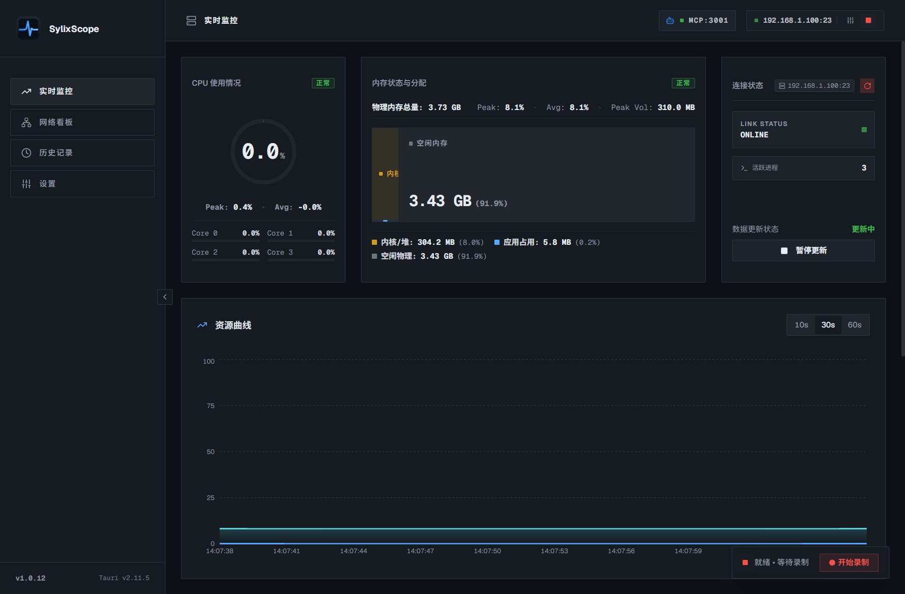
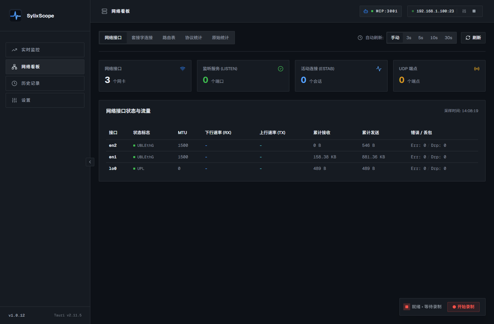

<p align="center">
  
</p>

<h1 align="center">SylixScope</h1>

<p align="center">
  面向 SylixOS 嵌入式实时操作系统的桌面监控与调测工具：通过 Telnet 直连板卡，零侵入地实时查看 CPU、内存、进程和网络状态。<br/>
  基于 Tauri 2 + React 19 + Rust，支持 Linux、macOS（Apple 芯片）、Windows x64 / ARM64。
</p>

<p align="center">
  <a href="https://github.com/kurerere/sylix-scope/releases/latest"></a>
  <a href="https://github.com/kurerere/sylix-scope/actions/workflows/release.yml"></a>
  <a href="LICENSE"></a>
</p>



## 特性

- **零侵入**：板卡端无需安装任何代理程序，只依赖系统自带的 Telnet 服务和 `top`、`ps`、`free`、`ifconfig`、`netstat` 等标准命令，网络可达即可监控。
- **实时监控**：总 CPU 与各核利用率、物理内存分布（内核/堆、应用、空闲）、10s / 30s / 60s 资源曲线、活跃进程列表（含命令行与可执行文件路径），超过阈值时告警。
- **网络看板**：网络接口状态与流量速率、套接字连接（监听 / 活动 / UDP）、路由表、协议统计，支持按需或定时刷新。
- **历史录制**：采集数据秒级归档到本地 SQLite，支持录制、暂停、重命名、删除、回放，并可导出为 JSON。
- **MCP 服务**：内置 Model Context Protocol 服务（Streamable HTTP / SSE），让 Cursor、Claude Desktop、Codex 等 AI 工具直接读取板卡的实时指标、进程和网络信息，或管理录制；带 Token 鉴权，执行 Shell 命令的能力可单独关闭。
- **低干扰采集**：核心指标 1 秒一次；进程详情只在发现新进程时异步查询并缓存，尽量减少对板卡 CPU 和 Telnet 通道的占用。
- 深色 / 浅色主题，适合在调试现场长时间查看。



## 下载

到 [Releases](https://github.com/kurerere/sylix-scope/releases/latest) 下载对应平台的安装包：

| 平台 | 文件 |
|---|---|
| Linux x64 | `*_linux-amd64.deb`（Debian / Ubuntu）、`*_linux-amd64.rpm`（Fedora / openSUSE 等）、`*_linux-amd64.AppImage`（通用） |
| macOS（Apple 芯片） | `*_macos-arm64.dmg` |
| Windows x64 | `*_windows-amd64-setup.exe`（推荐）、`*_windows-amd64.msi`、`*_windows-amd64-portable.exe`（免安装） |
| Windows ARM64 | `*_windows-arm64-setup.exe`（推荐）、`*_windows-arm64-portable.exe`（免安装） |

- **macOS**：安装包没有签名，首次打开前请在终端执行 `xattr -cr /Applications/SylixScope.app`。
- **Linux AppImage**：下载后执行 `chmod +x *.AppImage` 再运行。
- **Windows 免安装版**：需要系统已有 WebView2 运行时（Windows 10/11 通常已内置）。

## 使用

1. 确认 SylixOS 板卡已开启 Telnet 服务（默认端口 23），并且与电脑网络互通。
2. 点击右上角的连接配置，填写板卡 IP、端口、用户名和密码（默认 `root` / `root`）。
3. 点击“开始连接”，即可看到实时数据；需要留档时点击右下角“开始录制”。

### 接入 AI 工具（MCP）

点击顶部的 `MCP` 按钮打开服务面板，选择传输协议后点击“复制配置”，粘贴到 AI 工具的 MCP 配置里即可。提供的工具包括：

| 工具 | 作用 |
|---|---|
| `sylixos_get_realtime_metrics` | 读取 CPU、内存等实时指标 |
| `sylixos_list_processes` / `sylixos_get_process_detail` | 进程列表与进程详情 |
| `sylixos_get_network_info` | 网络接口、连接、路由等信息 |
| `sylixos_start_monitoring` / `sylixos_stop_monitoring` | 开始 / 停止监控 |
| `sylixos_manage_recording` | 管理历史录制 |
| `sylixos_execute_command` | 在板卡上执行 Shell 命令（可在面板中关闭“允许 Shell 执行”禁用） |

MCP 服务默认监听所有网卡，局域网内持有 Token 的客户端都可以访问。如果只在本机使用，或者不希望 AI 在板卡上执行命令，请关闭“允许 Shell 执行”并妥善保管 Token。

### 数据存储

录制数据库 `history.db` 保存在系统的应用数据目录（可在“设置”中一键打开）：

| 系统 | 路径 |
|---|---|
| Windows | `%APPDATA%\io.github.kurerere.sylixscope` |
| macOS | `~/Library/Application Support/io.github.kurerere.sylixscope` |
| Linux | `~/.local/share/io.github.kurerere.sylixscope` |

从旧版 SylixOS Monitor 升级时，首次启动会自动把旧数据目录（`com.sylixos.monitor`）中的录制数据复制过来，旧目录保持不变。

## 架构


- **前端**：React 负责看板渲染，业务逻辑放在 hooks 中，通过 Tauri IPC 与后端通信。
- **后端（Rust / Tokio）**：遥测引擎管理采集生命周期，Telnet 客户端负责与板卡交互，SQLite 模块负责录制的读写，内置 axum 实现 MCP 服务。


设计决策记录见 [`docs/adr`](docs/adr)，功能规格见 [`docs/specs`](docs/specs)，界面设计规范见 [`docs/design.md`](docs/design.md)。

## 开发

需要 [Rust](https://rustup.rs/)、Node.js 22+ 和 pnpm；Linux 还需要 [Tauri 的系统依赖](https://v2.tauri.app/start/prerequisites/)。

```bash
pnpm install
pnpm tauri dev        # 开发模式
pnpm test             # 前端单元测试
pnpm test:e2e         # Playwright 端到端测试
pnpm lint             # 代码检查
pnpm fmt:write        # 格式化
cd src-tauri && cargo test   # 后端测试（含模拟 SylixOS Telnet 服务的集成测试）
```

打包：

```bash
pnpm tauri build                 # 当前平台的安装包
make build-windows-arm64         # 交叉编译等目标见 Makefile
```

## 发布

推送 `v*` 格式的 tag 会触发 GitHub Actions（[`.github/workflows/release.yml`](.github/workflows/release.yml)）：先跑测试，再并行构建四个平台的安装包，最后创建 Release 并附上 `SHA256SUMS.txt`。应用版本号取自 tag。

```bash
git tag v1.0.12
git push origin v1.0.12
```

`v1.2.3-beta.1` 这类预发布 tag 会标记为 Pre-release，Windows 只提供 NSIS 安装包（MSI 不支持非数字的预发布版本号）。在 Actions 页面手动运行工作流只构建产物，不创建 Release。

## 许可证

[GPL-3.0](LICENSE)
